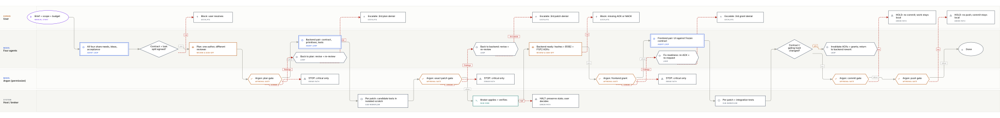

# Program Factory - Grunt Team

**The Grunt Team V1 is running, supervised.** The first app is `apps/text-annotator`; the host is `factory/host.mjs`. This repo also contains the **Super Team** design: a frontier pair that plans and programs, then delegates curated task cards to the grunt squad. The broker and OS sandbox are still not implemented; commit and push are manual Frontier Intelligence-gated steps, not host automation. Nothing runs unattended.



## V1 — text annotator

A local text annotator that loads `.txt`, `.md`, `.docx`, and text-layer `.pdf` files and labels spans. No OCR: a textless PDF or DOCX returns a clear error.

```bash
cd apps/text-annotator
node server.mjs      # http://localhost:4174
node --test          # 26 tests
```

- App: [`apps/text-annotator`](apps/text-annotator)
- Host: [`factory/host.mjs`](factory/host.mjs) — board, model calls, Frontier Intelligence gate, bundle apply, test gate. Supervised, not sandboxed.
- Task record: [`tasks/text-annotator`](tasks/text-annotator) — brief, contract, model bundles, reviews, Frontier Intelligence decisions, readiness hashes, test and browser evidence.
- The board for the run is `board/text-annotator/events.jsonl` (gitignored; `node factory/host.mjs verify text-annotator` checks the chain).

## Grunt Team

A small program is built by four technical agents, split by domain:

| ID | Model | Domain | Default role |
|---|---|---|---|
| **B1** | `deepseek/deepseek-flash` with `--thinking max` (default); optional `mistral/zai-glm-5-3-flash` | backend | author |
| **B2** | `deepseek/deepseek-flash` with `--thinking max` (default); optional `mistral/zai-glm-5-3-flash` | backend | independent reviewer |
| **F1** | `openai-codex/gpt-6-luna` | frontend | author |
| **F2** | `openai-codex/gpt-6-luna` | frontend | independent reviewer |

B1 and B2 can select `mistral/zai-glm-5-3-flash` per call with `--model`; omitting the option keeps DeepSeek Flash as the default.

The four are peers. They discuss the contract and the task split on a shared board before anyone writes code. The default for each patch is one author and a different reviewer, but the pair may co-design first; if both write, they split into separate patches so each still gets an independent review.

There is no fifth supervisor-agent. The host is deterministic plumbing: it routes messages, runs tests, and applies approved patches. It does not decide technical questions.

**Frontier Intelligence** is the permission gate. The default instance is **Argon** (`google/gemini-4-argon`, no tools). Frontier intelligence must approve the plan, every persistent patch, the frontend start, the task card, the commit, and the push. It is not a technical code reviewer. The user remains the principal and resolves technical disagreements. Its approval is a policy decision, **not** a security boundary; the host broker must enforce it, and that broker is not built yet.

## Super Team (design)

The Super Team adds two frontier agents above the same grunt squad:

| ID | Model | Owns |
|---|---|---|
| **A1** | `openai-codex/gpt-6.1-sol` | architecture, contract, task cards, red tests, frontier review |
| **A2** | `openai-codex/gpt-6-sol` | lead programming, integration, feasibility review |

A1/A2 handle the ambiguity and the hard code. They write a **task card** for anything that should go to B1/B2/F1/F2: exact files and interfaces, no open design decisions, red tests, a patch budget, a named grunt review pair, and stop conditions. A2 reviews feasibility; Frontier Intelligence gates the card scope. The grunt patch still gets its own Frontier Intelligence patch packet. A1 then reviews the grunt result against the card and tests; if the card was vague, it returns to A1, not the grunt pair.

A task that cannot be narrowed stays on the frontier track. The rule is **frontier time buys narrowness**, not "frontier models are smarter."

- Design: [`docs/super-team.md`](docs/super-team.md)
- Flow: [`docs/flowchart-super.svg`](docs/flowchart-super.svg)
- Card template: [`templates/task-card.md`](templates/task-card.md)

## Backend first

The backend pair owns the versioned API/schema/error contract, the primitives, and the tests. The frontend pair is the consumer: before readiness it can post needs, user flows, UI state matrices, acceptance criteria, fixture needs, and read-only contract reviews on the board. It cannot create persistent frontend artifacts or UI code.

A backend handoff is accepted only when:

- the contract version and canonical hash, fixtures, tests, docs/examples, and backend tree are pinned;
- the backend author attests and a different backend reviewer approves the exact candidate;
- both frontend agents individually ACK the **same** readiness, contract, fixture, and test hashes;
- there is no open NACK.

Then Frontier Intelligence grants frontend scope, bound to those hashes. If any gating hash changes, the ACKs, grants, integration result, and commit eligibility are invalidated. Backend reworks, retests, and re-ACKs before affected frontend work resumes.

## The patch gate

Every patch, in either pair, follows the same cycle:

1. One author proposes an exact diff in memory. No write tools.
2. The other agent reviews that exact diff in a fresh context.
3. The host runs the candidate tests in isolated scratch. The target tree is untouched.
4. If review or tests fail, the author revises. At most three review/test attempts; a repeated finding or exhausted attempts escalates to the user.
5. Frontier Intelligence reviews a one-use packet naming the root, paths, base, diff hash, test evidence, nonce, and expiry. If it denies with findings, the author revises, the reviewer re-reviews, the tests rerun, and the packet is rebuilt. Up to three rounds; the third denial escalates to the user.
6. A broker validates the live bindings and applies only that patch, then verifies the result.
7. A post-apply mismatch halts and preserves state. No silent repair, rollback, or cleanup. Only a major security or runtime issue is a hard stop.

The detailed gate, including both revision loops, is in [`docs/flowchart-patch.svg`](docs/flowchart-patch.svg).

## The shared board

`board/<task-id>/events.jsonl` is an append-only technical log, gitignored, written by the host. It carries needs, questions, proposals, objections, ACKs/NACKs, evidence, readiness, handoffs, and change requests.

Rules:

- The board is evidence, never permission. An ACK or a decision does not authorize a filesystem change.
- The host attaches actor identity. Agents cannot forge another agent's ACK or a Frontier Intelligence approval.
- Frontier Intelligence approves the exact board path and a narrow task-scoped append capability before use.
- Two proposals and one objection per decision. Silence is not consent. A missed reply, NACK, or repeated objection blocks and goes to the user.

The board and the Frontier Intelligence authority ledger are separate. The ledger records permissions; the board records reasoning and evidence.

## Permission gates

| Gate | What Frontier Intelligence approves |
|---|---|
| Board | exact storage path + task-scoped append capability |
| Plan | exact scope, owners, acceptance criteria |
| Every patch | exact paths, base, diff hash, test evidence, nonce, expiry |
| Frontend start | exact backend tree + readiness/contract/fixture hashes |
| Super task card | exact files, tests, budget, grunt pair, stop conditions |
| Commit | exact root, HEAD, tree, message, ref, identity |
| Push | exact URL, one explicit ref, commit, expected remote OID |

Each is one-use. No phase-wide approval, no reusing a patch approval, no reusing a plan approval. A denial with findings is an iteration: revise, re-review, resubmit, up to three Frontier Intelligence rounds, then the user. An unavailable gate is a stop because no review can happen. Only a major security or runtime issue is a hard stop.

## Independent code review

A technical code review is separate from permission. The default optional reviewer is **Astra** (`openai-codex/gpt-6-astra`) via `factory/host.mjs ask ASTRA ...`. **Claude** is handoff-only: generate the packet in [`templates/independent-review.md`](templates/independent-review.md), use a fresh Claude CLI session, and return findings. If a human choice between Astra and Claude is needed, wait at most 5 minutes; no reply means Astra; if Astra is out of usage, deny the review. If review cannot happen, save a local checkpoint with no push, run one degraded round with the active project model, mark it not independent, and leave the notes for the independent review. Priority 1 on return.

Full policy: [`docs/independent-review.md`](docs/independent-review.md).

The focused loop diagrams are [`docs/flowchart-plan.svg`](docs/flowchart-plan.svg) and [`docs/flowchart-patch.svg`](docs/flowchart-patch.svg). Both draw the return edge to review, the three-round bound, the user escalation, and the critical-only stop.

## Current state

- Remote `origin` is <https://github.com/patelpb96/sideapps>; `main` is pushed. Push automation is not implemented.
- `factory/host.mjs` is a supervised facilitator: it keeps a hash-chained board, calls the configured roles (frontier and grunt) with no tools, asks Frontier Intelligence, applies only approved bundles, and runs tests.
- `apps/text-annotator` is built and tested: 26/26 tests pass; a browser smoke test added a real annotation.
- The broker and OS sandbox are still not implemented. Commit and push are manual Frontier Intelligence-gated steps; the host does not automate them. The host is not a security boundary.
- The diagrams are generated from the JSON specs in `docs/` with the Flow engine in the parent `smallapps` repo.

See [`docs/roadmap.md`](docs/roadmap.md) for the build order and [`docs/runbook.md`](docs/runbook.md) for the supervised operating procedure.

## Layout

| Path | What |
|---|---|
| `AGENTS.md` | short operating rules for agents |
| `factory/` | V1 supervised host and its README |
| `apps/text-annotator/` | the first built app |
| `tasks/text-annotator/` | brief, contract, model bundles, reviews, gates, evidence |
| `docs/architecture.md` | the full design: roles, board, readiness, patch lifecycle, change control |
| `docs/flowchart.md` | how to read the five diagrams |
| `docs/super-team.md` | frontier-plus-grunt design and delegation gate |
| `docs/flow*.json` | authored Flow specs (the source of the SVGs) |
| `docs/flowchart*.svg` | rendered diagrams |
| `docs/runbook.md` | interim supervised commands and future broker flow |
| `docs/roadmap.md` | implementation order |
| `config/roles.json` | declarative roles, gates, and limits |
| `config/review-policy.json` | independent review routing and fallback policy |
| `templates/program-brief.md` | brief template |
| `templates/task-card.md` | Super Team delegation card |
| `templates/independent-review.md` | Astra/Claude review packet |
| `docs/independent-review.md` | review routing, 5-minute rule, degraded fallback |
| `HANDOFF.md` | bootstrap state and the guard note |
