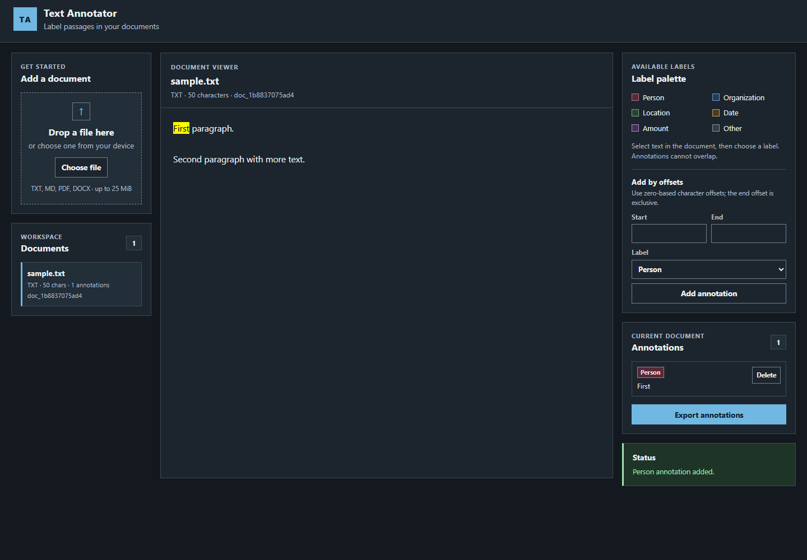

# Text Annotator V1

A local web app that loads a document and labels spans of text. It is the first
test program built with the program-factory V1.



## Run

```bash
cd apps/text-annotator
node server.mjs            # http://localhost:4174
PORT=4180 node server.mjs  # different port
```

No install, no build step, no npm dependencies. Node 20+.

## Supported inputs

| Format | Path |
|---|---|
| `.txt`, `.md` | UTF-8 text; BOM and CRLF normalized; paragraphs split on blank lines |
| `.docx` | `word/document.xml` extracted with a small built-in ZIP reader |
| `.pdf` | the existing text layer through `pdftotext`; no OCR |

PDF extraction needs `pdftotext` on `PATH` (Poppler). If it is missing, the
server returns `PDF_TOOL_MISSING`. A scanned PDF, an empty file, or a textless
DOCX returns `NO_TEXT` with a readable message. That is expected; OCR is out of
scope.

Limits: 25 MiB upload; DOCX XML 20 MiB; PDF extraction 20 s and 10 MiB stdout.

## Use

1. Drop a file or choose one. The document is extracted and saved under `data/`.
2. Open it from the document list.
3. Select a passage and choose a label, or use **Add by offsets** for a
   keyboard-operable path (zero-based, end-exclusive).
4. Delete an annotation from the list, or export the document's annotations as
   JSON.

Labels: `Person`, `Organization`, `Location`, `Date`, `Amount`, `Other`.
Annotations cannot overlap in V1. The UI rejects an overlap with a message.

`data/` is gitignored. It contains `documents/<id>.json` and
`annotations/<id>.json`.

## API

```text
POST   /api/documents                         raw bytes + X-Filename
GET    /api/documents                         list summaries
GET    /api/documents/:id                     full document
DELETE /api/documents/:id                     delete document + annotations
GET    /api/documents/:id/annotations         list
PUT    /api/documents/:id/annotations         replace list
```

Upload example:

```bash
curl -X POST \
  -H 'Content-Type: application/octet-stream' \
  -H 'X-Filename: sample.txt' \
  --data-binary @test/fixtures/sample.txt \
  http://localhost:4174/api/documents
```

Errors are `{ "error": { "code": "...", "message": "..." } }`.

## Tests

```bash
node --test
```

26 tests: extraction (TXT/MD/DOCX/PDF, BOM/CRLF, NO_TEXT, unsupported), store,
annotation validation, API, and static assets. The two PDF tests skip if
`pdftotext` is not installed.

Browser smoke tests were run separately: the offset form added a `Person`
annotation at 0–5 (`<mark>First</mark>`), and a mouse selection added `Second`
and then `paragraph` after the first mark rendered. Evidence:
`../../tasks/text-annotator/evidence/browser-smoke.json` and
`browser-selection.json`.

## Known limits

- No OCR; a PDF without a text layer is rejected.
- No `.doc` (binary) support.
- No overlapping spans.
- No multi-user or authentication; it is a local single-user tool.
- No model-assisted labeling.
