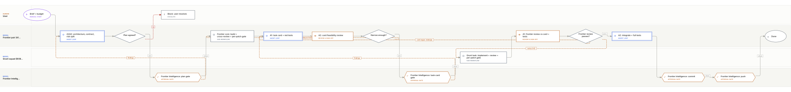

# Program Factory - Super Team

**Status: design.** The host knows the frontier roles, but no Super Team build has run yet. The first working build is the Grunt Team's text annotator.

This is the second mode of the same factory. The Grunt Team is four agents doing contract-first work. The Super Team adds two frontier agents who own ambiguity, architecture, the hard code, test design, and final review. The grunt squad still does the volume, but only on a card that is narrow enough to be delegated.

## Why this mode

Some work is not a volume problem. It is a judgement problem: a new architecture, a security boundary, a parser with a subtle grammar, a performance regression, a contract that will be hard to change. A cheap worker with a vague task will produce a plausible wrong answer. The Super Team spends frontier time to remove that ambiguity, then hands the remaining work to the grunt squad with tests that already say what "done" means.

The rule is not "frontier models are smarter." The rule is **frontier time buys narrowness**. If a task cannot be narrowed, it stays on the frontier track.

## Roles

| Role | Model | Owns |
|---|---|---|
| **A1** | `openai-codex/gpt-6.1-sol` | architecture, scope, contract, task cards, red tests, frontier review |
| **A2** | `openai-codex/gpt-6-sol` | lead programming, integration, feasibility review, hard modules |
| **B1/B2** | `deepseek/deepseek-flash --thinking max` | backend grunt author/reviewer |
| **F1/F2** | `openai-codex/gpt-6-luna` | frontend grunt author/reviewer |
| **Frontier Intelligence** | `google/gemini-4-argon` by default (Argon), no tools | permission gate only |
| **Host** | `factory/host.mjs` | board, model calls, Frontier Intelligence gates, apply, tests |
| **User** | — | principal, scope, budget, disputes |

A1 and A2 are a frontier pair, not a supervisor layer. They can both write code; the default is one author and the other reviewer per patch. Two frontier sessions check each other: A1 plans and A2 checks feasibility; A2 implements and A1 checks intent. They are not the independent review layer; use Astra or Claude for high-risk patches.

Frontier Intelligence is unchanged. The default instance is Argon. It does not judge architecture and it is not a frontier reviewer. It gates the plan, each persistent patch, the task card's scope, the commit, and the push. Its decision is policy, not enforcement.

## Two tracks

**Frontier core.** A1/A2 own the architecture, the contract, the risky modules, the integration seams, and the final integration. Every frontier patch uses the same per-patch gate as the Grunt Team: one author, a different reviewer, candidate tests, an exact Frontier Intelligence packet, broker apply, post-verify.

**Grunt cards.** A bounded task is delegated only after it has a task card. The card freezes the goal, files, interfaces, non-goals, tests, review pair, budget, and stop conditions. The grunt pair implements it, reviews it, and returns a patch. It does not redesign the task.

## The delegation gate

A card is grunt-eligible only when **all** of these are true:

1. **One goal, one sentence.** If it needs "and" to explain the outcome, split it.
2. **Exact files and interfaces.** The card names allowed paths, types, functions, endpoints, and fixtures.
3. **No open design decision.** The card does not ask the grunt pair to choose an architecture, a schema, a library, or a security boundary.
4. **Red tests exist.** A1 writes the failing tests; A2 reviews them. The card includes the exact commands and the test hash.
5. **Budget.** Maximum files, lines, and review attempts (usually three).
6. **Review pair.** B1/B2 for backend or F1/F2 for frontend, one author and a different reviewer.
7. **Non-goals and do-not-touch.** The card says what must not change.
8. **Stop conditions.** Interface change, new dependency, test failure, budget exceeded, or an unclear requirement means stop and return to A1.

If any line is false, the task is **not delegable**. It stays on the frontier track or A1 narrows it further. A1 can use `templates/task-card.md`; A2 reviews feasibility; Frontier Intelligence approves the card's exact scope before the grunt pair starts.

A task card is a scope authorization, not a patch approval. The grunt patch still needs its own Frontier Intelligence one-use patch packet.

## Frontier loop

```text
A1/A2 frame scope + architecture + contract
  -> Frontier Intelligence plan gate
  -> frontier core: A2 builds, A1 reviews, same patch gate
  -> A1 writes task cards + red tests
  -> A2 reviews feasibility
  -> narrow enough? no -> keep on frontier
  -> yes -> Frontier Intelligence task-card gate
```

A1 owns the card and the tests. A2 owns the feasibility check and the hard implementation. Neither can approve the other's work alone: a different agent reviews each patch.

## Grunt loop

```text
accepted card + exact tests
  -> B1/B2 or F1/F2: author proposes, different reviewer checks
  -> host runs the card tests
  -> Frontier Intelligence exact patch gate
  -> broker apply + post-verify
  -> A1 frontier review against the card and tests
  -> pass -> A2 integrates
  -> fail -> grunt revises, up to 3 rounds
             or A1 redesigns the card if it was vague
```

The grunt team may add tests. It may not weaken, delete, skip, or rewrite a frontier test to make a patch pass. If the implementation needs a new interface or a new dependency, it stops and returns to A1. That is not a grunt failure; it is evidence that the card was not narrow enough.

## Frontier review

A1's review is not a rubber stamp on a green test run. It checks:

- the patch matches the card's files, interfaces, and non-goals;
- no unrelated refactor or scope creep;
- the tests still describe the intended behavior;
- the implementation is the least surprising one, not merely a passing one;
- the card's assumptions still hold.

If the failure is **implementation**, it goes back to the grunt pair, up to three rounds. If the failure is **the card**, it goes back to A1/A2. The distinction matters: a vague card is a frontier defect, not a grunt defect.

## Independent review

A1's frontier review is technical but not independent: A1 is part of the team that shaped the card. For a high-risk frontier patch or a security boundary, add Astra (`openai-codex/gpt-6-astra`) or a Claude handoff review. The route, the 5-minute human-choice rule, the deny rule, and the one-round degraded fallback are in [`docs/independent-review.md`](independent-review.md).

## Change control

A grunt card cannot change the contract, architecture, or dependency set. If it discovers that the card is wrong:

1. stop the patch;
2. record the reason on the board;
3. return to A1/A2;
4. revise the contract or card, re-run the plan/task-card gates;
5. issue a new card with new tests and hashes.

The prior card, test hash, and patch approval are stale. No grunt agent "works around" a contract problem.

## Cost and throughput

Frontier tokens are expensive; grunt tokens are cheap. The split is deliberate:

- **Frontier:** ambiguity, architecture, contract, hard code, test design, integration, final review.
- **Grunt:** bounded implementation, fixtures, mechanical refactors, UI slices, test harnesses, well-specified migrations.
- **Frontier Intelligence:** small exact packets, not technical debate.
- **Cards:** one frontier review of the card, then one frontier review of the resulting patch. More rounds require a recorded reason.

A card that produces three failed grunt rounds is a signal to re-scope, not to add a fourth round. The repeat rule applies: the same finding twice is a card/spec defect, not a prompt to try harder.

## Failure modes

| Symptom | Real cause | Response |
|---|---|---|
| Grunt patch passes tests but is wrong | tests were too weak or the card was vague | A1 rejects; strengthen the card/tests, not the prompt |
| Grunt asks for a new interface | card left a design decision open | stop; return to A1; do not let grunt redesign |
| A1 rewrites the card after every round | scope was not actually narrow | keep the task on the frontier track |
| Frontier review is a rubber stamp | A1 is reviewing the diff only, not intent | check the card's non-goals and the test hashes |
| Card is "implement the feature" | no exact files/interfaces/tests | not delegable |
| Approval fatigue | too many gates per small task | batch the card's patches under one card gate, but keep per-patch Frontier Intelligence approval |

## Flowchart



The diagram shows the two tracks and the delegation gate. The per-patch details are the same as the Grunt Team's patch diagram: `docs/flowchart-patch.svg`.

## Current state

- Roles A1/A2 are declared in `config/roles.json` and accepted by `factory/host.mjs`.
- No Super Team task has run yet; this is a design.
- The Grunt Team V1 (text annotator) is the baseline the Super Team will build on.
- Frontier Intelligence gates, the board, the host, and the commit/push gates are shared with the Grunt Team.
